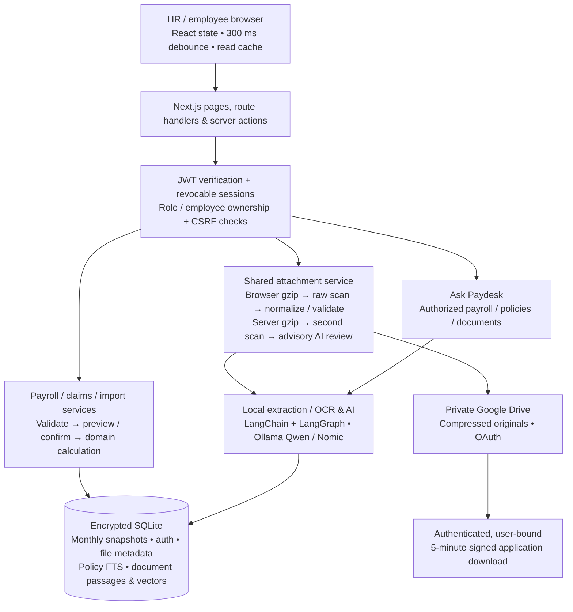

# Paydesk — system architecture

**Assessment summary · 10,000-employee target · implemented system**

One Next.js/React/TypeScript application, two role-based workspaces, one encrypted SQLite database on persistent disk. See [the printable one-page PDF](docs/architecture-one-page.pdf). Current requirements: [REQUIREMENTS.md](REQUIREMENTS.md); verification: [acceptance test cases](docs/CURRENT_TEST_CASES.md).

**Payroll correctness.** Store money as integer minor units with currency; one tested domain function rounds pay components and creates monthly snapshots. Salary editing preserves claims and rejects stale versions. Imports validate every row, stage an owner-bound draft and commit only after HR confirmation in a transaction. Claim approval recalculates the affected month. No tax/PF/ESI engine is claimed.

**Security.** Passwords use salted scrypt; HS256 JWTs are signed, not encrypted, and carry no salary data. Access lasts 10 minutes; rotating refresh credentials retain a 30-minute idle and 8-hour absolute limit with replay revocation. Cookies are HttpOnly/SameSite and Secure in production. SQLCipher-mode database encryption, AES-256-GCM Drive token protection, separate secrets, server-side authorization, bounded inputs and ClamAV protect sensitive paths. Drive files are private; application signatures do not make public Drive links.

**Optimization.** Indexed keyset pagination returns 25 employees, without loading the whole directory. Initial server data seeds React state and a bounded, account-scoped JSON memory cache: 15-second TTL, 50 entries, identical in-flight request sharing. Searches debounce at 300 ms; filter submits throttle at 500 ms. Explicit refresh, lifecycle/session clearing, aborts and sequence guards limit staleness and obsolete results. These controls do not cache mutations or guarantee zero repeated requests; diagnostics are aggregate counters, not full monitoring.

**AI boundaries.** New scan-passed uploads receive purpose/readability review; valid uploads proceed with visible unavailable status during AI failure. Code checks all sheet rows; AI reviews a bounded sample. PDF/image passages and Nomic vectors stay encrypted locally. Chat uses authorized payroll, owned documents and explicitly shared policy text; citations and sourced numbers are checked. Arithmetic runs in code. No AI payroll writes or approvals.

**Deployment and limits.** One app writer, persistent encrypted disk, HTTPS, Drive OAuth, ClamAV, local Ollama and OCR binaries. SQLite, Drive and AI are not one distributed transaction: reconciliation/backups remain operational work. Move the repository adapter to PostgreSQL when multiple app writers are needed. English OCR and memory-only conversations are limited; notifications, payroll tax rules, durable ingestion jobs and comprehensive model evaluation remain future work. The 10,000-row seed is tested, not a concurrency benchmark.
